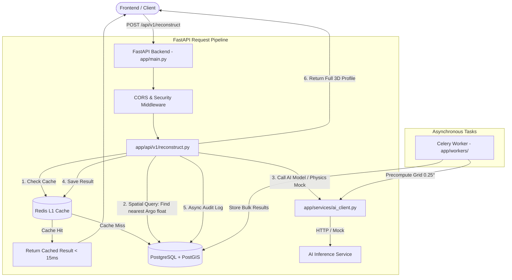

# 🌊 OceanEmbed (SIH 2026) — Complete Project Architecture & Codebase Guide

Welcome to the comprehensive architecture and file-by-file documentation of **OceanEmbed**. This document explains the complete workflow, system design, data flow, and the exact role of every file in the project.

---

## 📑 Table of Contents
1. [Project Overview & Problem Statement](#1-project-overview--problem-statement)
2. [High-Level Architecture & Request Flow](#2-high-level-architecture--request-flow)
3. [Infrastructure & Services](#3-infrastructure--services)
4. [File-by-File Detailed Breakdown](#4-file-by-file-detailed-breakdown)
   - [Core Configuration & Setup (`app/core/`)](#appcore)
   - [Database Layer & Models (`app/db/`)](#appdb)
   - [Pydantic Schemas & Contracts (`app/schemas/`)](#appschemas)
   - [Business Logic & Services (`app/services/`)](#appservices)
   - [REST API Endpoints (`app/api/`)](#appapi)
   - [Background Workers & Tasks (`app/workers/`)](#appworkers)
   - [Scripts & Database Seeding (`scripts/`)](#scripts)
   - [Database Migrations (`alembic/`)](#alembic)
   - [Docker & Environment Configs](#docker--environment)
5. [End-to-End Workflow Examples](#5-end-to-end-workflow-examples)
   - [Workflow A: `/reconstruct` Endpoint Execution](#workflow-a-reconstruct-endpoint-execution)
   - [Workflow B: Background Grid Precomputation](#workflow-b-background-grid-precomputation)
   - [Workflow C: NetCDF Argo Float Data Ingestion](#workflow-c-netcdf-argo-float-data-ingestion)
6. [How to Run & Verify Locally](#6-how-to-run--verify-locally)

---

## 1. Project Overview & Problem Statement

### 🎯 The Objective
Satellites can measure ocean surface parameters (Sea Surface Temperature - SST, Sea Surface Salinity - SSS, Sea Surface Height - SSH). However, satellites **cannot see underwater**. 
Ocean subsurface conditions (temperatures at depths from 0m down to 2000m) are critical for:
- Cyclone & monsoon intensity prediction
- Marine ecosystem monitoring
- Submarine acoustics & defense

### 💡 The Solution: OceanEmbed
OceanEmbed uses AI/Deep Learning to reconstruct the 3D subsurface temperature and salinity profile from surface data, ground-truthed against real **Argo Float profiles** stationed across the Indian Ocean (Arabian Sea, Bay of Bengal, Equatorial Zone).

---

## 2. High-Level Architecture & Request Flow



---

## 3. Infrastructure & Services

The system runs 4 Docker containers defined in [`docker-compose.yml`](file:///c:/web%20development/github_repos/SIH_Project_2026/backend/docker-compose.yml):

| Container Name | Service | Purpose | Port |
| :--- | :--- | :--- | :--- |
| **`oceanembed_backend`** | FastAPI (Uvicorn) | Main REST API server handling user requests, spatial searches, and caching. | `8000` |
| **`oceanembed_celery`** | Celery Worker | Background worker for heavy operations (0.25° grid pre-computations, data downloads). | Internal |
| **`oceanembed_postgres`** | PostGIS (PostgreSQL 16) | Geospatial database storing Argo profiles (`POINT` geometry), regions, and cached runs. | `5432` |
| **`oceanembed_redis`** | Redis 7 Alpine | Fast in-memory cache (<15ms response) and Celery message broker. | `6379` |

---

## 4. File-by-File Detailed Breakdown

### `app/core/` (Core Configuration & Setup)

* #### [`app/core/config.py`](file:///c:/web%20development/github_repos/SIH_Project_2026/backend/app/core/config.py)
  * **What it does:** Uses `pydantic-settings` to load and validate all environment variables from `.env`.
  * **Key components:**
    * `Settings` class: Defines variables like `DB_URL`, `REDIS_URL`, `AI_ENGINE_URL`, `DEPTH_LEVELS`, `GRID_RESOLUTION`.
    * `parse_depth_levels`: Custom Pydantic validator that intelligently accepts both comma-separated strings (`0,10,20`) and JSON arrays (`[0,10,20]`).
    * `@lru_cache() get_settings()`: Ensures settings are loaded once in memory and reused throughout the app.

* #### [`app/core/logging.py`](file:///c:/web%20development/github_repos/SIH_Project_2026/backend/app/core/logging.py)
  * **What it does:** Sets up structured JSON logging for production and human-readable logging for local development.
  * **Key components:** Injects `request_id` into every log entry so any API request can be traced across the whole server lifecycle.

* #### [`app/core/security.py`](file:///c:/web%20development/github_repos/SIH_Project_2026/backend/app/core/security.py)
  * **What it does:** Provides API key authentication and CORS security.
  * **Key components:** `verify_admin_key`: FastAPI dependency protecting sensitive admin endpoints (like manual re-indexing or ingestion triggers).

---

### `app/db/` (Database Layer & Models)

* #### [`app/db/base.py`](file:///c:/web%20development/github_repos/SIH_Project_2026/backend/app/db/base.py)
  * **What it does:** Defines SQLAlchemy's `Base = declarative_base()`, which all database models inherit from.

* #### [`app/db/session.py`](file:///c:/web%20development/github_repos/SIH_Project_2026/backend/app/db/session.py)
  * **What it does:** Manages async database connections to PostgreSQL using the `asyncpg` driver.
  * **Key components:**
    * `create_async_engine`: Asynchronous connection pool.
    * `get_db()`: FastAPI dependency yielding an async database session per request with automatic commit and rollback on errors.

* #### [`app/db/models/argo_profile.py`](file:///c:/web%20development/github_repos/SIH_Project_2026/backend/app/db/models/argo_profile.py)
  * **What it does:** Stores actual oceanographic ground-truth data from physical Argo floats.
  * **Key fields:**
    * `geom = Column(Geometry(geometry_type="POINT", srid=4326))`: PostGIS spatial point for indexing lat/lon.
    * `depths_m`: Array of depth levels (e.g. `[0, 10, 20, 50, 100, 200, 500, 1000, 2000]`).
    * `temperature_c`: Measured water temperatures (°C) at each depth.
    * `salinity_psu`: Measured salinity at each depth.

* #### [`app/db/models/region.py`](file:///c:/web%20development/github_repos/SIH_Project_2026/backend/app/db/models/region.py)
  * **What it does:** Stores key geographic boundaries (Arabian Sea, Bay of Bengal, Indian Ocean Equatorial Zone) with bounding boxes (`lat_min`, `lat_max`, `lon_min`, `lon_max`).

* #### [`app/db/models/reconstruction_cache.py`](file:///c:/web%20development/github_repos/SIH_Project_2026/backend/app/db/models/reconstruction_cache.py)
  * **What it does:** PostgreSQL persistent cache for precomputed or frequently queried profiles, ensuring fast lookups without re-running the AI model.

* #### [`app/db/models/query_log.py`](file:///c:/web%20development/github_repos/SIH_Project_2026/backend/app/db/models/query_log.py)
  * **What it does:** Records an audit trail of user queries (coordinates, date, execution time, cache hit/miss) for analytics.

---

### `app/schemas/` (Pydantic Data Contracts)

* #### [`app/schemas/reconstruct.py`](file:///c:/web%20development/github_repos/SIH_Project_2026/backend/app/schemas/reconstruct.py)
  * **What it does:** Defines the strict request and response contracts for the `/reconstruct` endpoint.
  * **Request:** `latitude`, `longitude`, `date`.
  * **Response:** `depths_m`, `temperature_c`, `confidence`, `nearest_argo`, `cache_hit`, `is_mock`.

* #### [`app/schemas/argo.py`](file:///c:/web%20development/github_repos/SIH_Project_2026/backend/app/schemas/argo.py)
  * **What it does:** Defines schemas for nearest Argo float queries (`ArgoNearestRequest`, `ArgoProfileResponse`).

---

### `app/services/` (Business Logic & External Integrations)

* #### [`app/services/ai_client.py`](file:///c:/web%20development/github_repos/SIH_Project_2026/backend/app/services/ai_client.py)
  * **What it does:** The bridge between the FastAPI backend and the AI Deep Learning model.
  * **Dual Modes:**
    1. **Live HTTP Mode:** When `AI_ENGINE_URL` is set to an HTTP endpoint, it sends an async POST request to the AI model container.
    2. **Physics-based Mock Mode:** When `AI_ENGINE_URL=mock`, it generates physically accurate ocean profiles using realistic thermodynamic equations (Surface Mixed Layer, Thermocline exponential drop, Deep Abyssal cold zone) so frontend development can proceed without waiting for the trained model!

* #### [`app/services/cache_service.py`](file:///c:/web%20development/github_repos/SIH_Project_2026/backend/app/services/cache_service.py)
  * **What it does:** Redis caching manager.
  * **Key components:**
    * `make_cache_key()`: Rounds coordinates to the nearest grid resolution (e.g. 0.25°) to maximize cache hits.
    * `get_cached_reconstruction()` / `set_cached_reconstruction()`: Reads/writes JSON cached profiles with configurable TTL (1 hour default).

* #### [`app/services/argo_lookup.py`](file:///c:/web%20development/github_repos/SIH_Project_2026/backend/app/services/argo_lookup.py)
  * **What it does:** Performs high-performance PostGIS spatial queries using `ST_Distance` and PostGIS spatial indexing.
  * **Logic:** Finds the closest real Argo float profile within a time window (e.g., ±30 days) and calculates the exact geodesic distance in kilometers.

* #### [`app/services/ingestion/loader.py`](file:///c:/web%20development/github_repos/SIH_Project_2026/backend/app/services/ingestion/loader.py)
  * **What it does:** Ingests raw NetCDF (`.nc`) files from the Argo global ocean observation network, parses Julian dates, depths, temperatures, and stores them into PostGIS.

---

### `app/api/` (API Routes & Endpoints)

* #### [`app/main.py`](file:///c:/web%20development/github_repos/SIH_Project_2026/backend/app/main.py)
  * **What it does:** Application root.
  * **Features:**
    * Lifespan management: Initializes DB connection pools on startup and closes them gracefully on shutdown.
    * Middleware: Adds CORS headers (allowing React/Vite frontend) and unique `X-Request-ID` tracking.
    * `/health` and `/ready` endpoints.
    * Mounts `/api/v1` router.

* #### [`app/api/v1/router.py`](file:///c:/web%20development/github_repos/SIH_Project_2026/backend/app/api/v1/router.py)
  * **What it does:** Combines all sub-routes into a unified `/api/v1` router.

* #### [`app/api/v1/reconstruct.py`](file:///c:/web%20development/github_repos/SIH_Project_2026/backend/app/api/v1/reconstruct.py)
  * **What it does:** Core API endpoint (`POST /api/v1/reconstruct`). Coordinates Cache -> PostGIS Argo Lookup -> AI Model -> Response formatting.

* #### [`app/api/v1/argo.py`](file:///c:/web%20development/github_repos/SIH_Project_2026/backend/app/api/v1/argo.py)
  * **What it does:** Exposes `GET /api/v1/argo-nearest` for fetching real Argo float data near a given coordinate.

* #### [`app/api/v1/regions.py`](file:///c:/web%20development/github_repos/SIH_Project_2026/backend/app/api/v1/regions.py)
  * **What it does:** Exposes `GET /api/v1/regions` listing supported ocean zones (Arabian Sea, Bay of Bengal, etc.).

---

### `app/workers/` (Asynchronous Celery Tasks)

* #### [`app/workers/celery_app.py`](file:///c:/web%20development/github_repos/SIH_Project_2026/backend/app/workers/celery_app.py)
  * **What it does:** Initializes the Celery background worker connected to Redis (`redis://redis:6379/1`).

* #### [`app/workers/tasks.py`](file:///c:/web%20development/github_repos/SIH_Project_2026/backend/app/workers/tasks.py)
  * **What it does:** Defines Celery tasks such as `precompute_region`.
  * **Logic:** Iterates over a region's lat/lon grid in steps of 0.25°, runs the AI model in the background, and pre-populates the cache so frontend map loads instantly!

---

### `scripts/` (Database Seeding)

* #### [`scripts/seed_regions.py`](file:///c:/web%20development/github_repos/SIH_Project_2026/backend/scripts/seed_regions.py)
  * **What it does:** Runs on container startup to populate default ocean regions (Arabian Sea, Bay of Bengal, Equatorial Zone) into the `regions` table.

* #### [`scripts/seed_argo_sample.py`](file:///c:/web%20development/github_repos/SIH_Project_2026/backend/scripts/seed_argo_sample.py)
  * **What it does:** Seeds synthetic Argo profiles across the Indian Ocean for testing spatial queries before real NetCDF data is downloaded.

---

### `alembic/` (Database Schema Versioning)

* #### [`alembic/env.py`](file:///c:/web%20development/github_repos/SIH_Project_2026/backend/alembic/env.py)
  * **What it does:** Alembic migration runner configured for SQLAlchemy 2.0 async engine (`asyncpg`).
* #### [`alembic/versions/`](file:///c:/web%20development/github_repos/SIH_Project_2026/backend/alembic/versions/)
  * Contains versioned SQL migration scripts that automatically create tables, foreign keys, and PostGIS spatial indexes.

---

### Docker & Environment

* #### [`docker-compose.yml`](file:///c:/web%20development/github_repos/SIH_Project_2026/backend/docker-compose.yml)
  * Orchestrates all 4 containers with health checks, persistent volumes, environment sharing, and network isolation.
* #### [`Dockerfile`](file:///c:/web%20development/github_repos/SIH_Project_2026/backend/Dockerfile)
  * Multi-stage build (Builder stage compiles wheels, Runtime stage uses lightweight `python:3.11-slim` with a non-root `oceanembed` user).
* #### [`.env`](file:///c:/web%20development/github_repos/SIH_Project_2026/backend/.env) / [`.env.example`](file:///c:/web%20development/github_repos/SIH_Project_2026/backend/.env.example)
  * Environment variables (Database credentials, Redis URLs, AI Engine toggle, Depth levels).
* #### [`.vscode/settings.json`](file:///c:/web%20development/github_repos/SIH_Project_2026/.vscode/settings.json)
  * Configures the local developer IDE with `.venv` Python path and backend analysis paths, eliminating editor import warnings.

---

## 5. End-to-End Workflow Examples

### Workflow A: `/reconstruct` Endpoint Execution

```
[User on Frontend Map] 
     │
     ▼ Clicks on coordinate: lat=15.0, lon=70.0, date=2024-05-15
[POST /api/v1/reconstruct]
     │
     ├── Step 1: `cache_service.py` computes key: "rec:15.00:70.00:2024-05-15"
     │   └── Checks Redis -> If found, returns in < 15ms!
     │
     ├── Step 2: If Miss -> `argo_lookup.py` queries PostGIS:
     │   └── "SELECT * FROM argo_profiles ORDER BY geom <-> ST_SetSRID(ST_Point(70, 15), 4326) LIMIT 1"
     │   └── Finds nearest physical Argo float (e.g. 42 km away).
     │
     ├── Step 3: `ai_client.py` computes subsurface profile:
     │   └── Computes temperatures at depths: [0m, 10m, 20m, 50m, 100m, 200m, 500m, 1000m, 2000m]
     │
     ├── Step 4: `cache_service.py` saves output into Redis with 1h TTL.
     │
     └── Step 5: Returns JSON response containing both AI reconstructed profile + Nearest Argo ground truth!
```

---

## 6. How to Run & Verify Locally

### 1. Start all containers:
```bash
cd backend
docker-compose up -d
```

### 2. Verify all containers are healthy:
```bash
docker ps
```
*(All 4 containers will show `Up (healthy)`)*

### 3. Check health endpoint:
```bash
curl http://localhost:8000/health
# Response: {"status":"ok","env":"development"}
```

### 4. Interactive Swagger Documentation:
Open your browser and navigate to:
**[http://localhost:8000/docs](http://localhost:8000/docs)**
You can test `/api/v1/reconstruct`, `/api/v1/argo-nearest`, and `/api/v1/regions` directly with a graphical interface!
