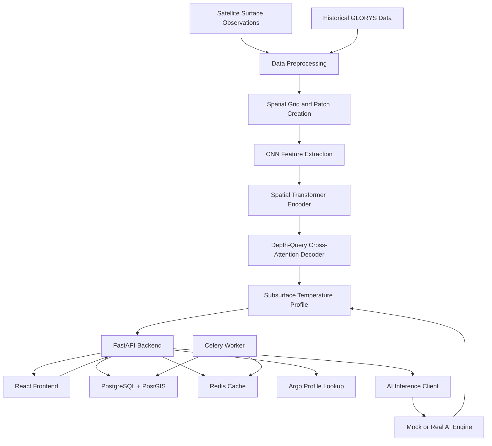

# 🌊 OceanEmbed — AI-Powered Ocean Subsurface Reconstruction

<p align="center">
  <strong>Smart India Hackathon 2026</strong>
  <br />
  <em>Reconstructing the hidden ocean using satellite observations, deep learning, and scientific data.</em>
</p>

<p align="center">
  
  
  
  
  
  
</p>

---

## 📌 Overview

**OceanEmbed** is an AI-powered oceanographic system designed to reconstruct subsurface ocean temperature profiles from satellite-derived surface observations and historical oceanographic data.

Satellites provide valuable information about the ocean surface, but they cannot directly observe the complete vertical temperature structure beneath it. OceanEmbed aims to bridge this gap using a deep-learning architecture that combines convolutional feature extraction, spatial Transformer attention, and depth-query cross-attention.

The project combines a PyTorch-based AI model, a FastAPI backend, geospatial data storage, and a React frontend to support location-based ocean profile reconstruction.

### The core idea

**Satellite observations → Spatial feature extraction → Transformer-based learning → Subsurface temperature reconstruction → Visualization**

The system is designed to estimate ocean temperature at multiple depths, with the backend supporting profile requests from 0 m to 2,000 m. The AI model's actual supported depth range depends on its configured output targets and trained checkpoint.

---

## 🎯 1. Problem Statement

Understanding the ocean requires more than surface observations. Temperature varies with depth and influences ocean circulation, climate processes, marine ecosystems, and underwater sound propagation.

Direct ocean measurements are valuable but do not provide uniform coverage across all locations and times.

The challenge is to estimate underwater temperature profiles from available surface variables while preserving spatial context and validating predictions against observed oceanographic data.

OceanEmbed addresses this challenge through:

- Multivariate satellite and oceanographic inputs.
- Spatial neighborhood-based feature extraction.
- Deep-learning-based vertical profile reconstruction.
- Historical reanalysis data for supervised training.
- Argo float observations for independent evaluation.
- A backend that serves location- and date-based requests.

## 💡 2. Proposed Solution

OceanEmbed uses a hybrid CNN–Transformer model to learn relationships between surface ocean conditions and subsurface temperatures.

The proposed solution has four major components:

1. **AI model:** Learns spatial patterns and reconstructs temperature profiles across depth levels.
2. **Backend API:** Accepts reconstruction requests, retrieves relevant ocean observations, manages caching, and communicates with the inference engine.
3. **Geospatial database:** Stores regional information and supports location-based ocean data queries.
4. **Frontend:** Provides an interface for requesting reconstructions and visualizing the resulting profiles.

The backend currently supports a mock AI mode for development and demonstration. Connecting the trained PyTorch model to the inference service is a separate integration step.

---

## 🏗️ 3. System Architecture



### Architecture components

| Component | Responsibility |
|---|---|
| React + TypeScript + Vite | Frontend interface and development server |
| FastAPI | HTTP API and backend orchestration |
| PyTorch | Training and inference for the reconstruction model |
| CNN + Transformer | Spatial representation learning |
| Depth-query decoder | Predicts temperatures at configured depth levels |
| PostgreSQL + PostGIS | Relational and geospatial storage |
| Redis | Caching and task coordination |
| Celery | Asynchronous processing and batch precomputation |
| Alembic | Database schema migrations |
| SQLAlchemy | Database interaction |
| Docker Compose | Local multi-service deployment |
| GLORYS and Argo data | Training targets and observational validation |

---

## 🧠 4. AI Model Architecture

The model is implemented in PyTorch and is designed for spatially aware ocean subsurface temperature reconstruction.

Its primary architecture follows:

**CNN → Spatial Transformer Encoder → Depth-Query Cross-Attention Decoder**

### 4.1 Input features

The training notebook uses seven oceanographic input features:

| Feature | Description |
|---|---|
| `sst_ostia` | Sea surface temperature |
| `sss_smos` | Sea surface salinity |
| `ssh_duacs` | Sea surface height |
| `current_u` | Zonal ocean current component |
| `current_v` | Meridional ocean current component |
| `wind_u` | Zonal wind component |
| `wind_v` | Meridional wind component |

The model also receives a validity-mask channel, giving it **eight input channels** in total.

The mask distinguishes actual grid cells from missing or padded cells.

### 4.2 Spatial patch construction

The notebook constructs a 21 × 21 neighborhood around each target location.

This allows the model to learn spatial relationships across neighboring ocean grid cells instead of relying only on the features at a single coordinate.

To reduce data-loading overhead, the notebook precomputes spatial patches before training rather than rebuilding them in every batch.

### 4.3 CNN feature extraction

Convolutional layers extract local spatial patterns from the input patch.

The intended multi-scale design uses different convolution kernel sizes to capture patterns at different spatial scales.

These representations provide spatial features for the Transformer encoder.

### 4.4 Spatial Transformer encoder

The model uses a spatial Transformer encoder to learn relationships between the extracted features.

The documented baseline configuration uses:

- Embedding dimension: 192
- Encoder layers: 4
- Attention heads: 8
- Dropout: 0.10
- Two-dimensional spatial positional embeddings

This allows the model to combine information from different locations within the input patch.

### 4.5 Depth-query cross-attention decoder

The decoder uses learned depth queries to generate predictions for multiple underwater levels.

The baseline configuration uses three cross-attention decoder layers.

Each query represents a target depth, allowing the model to produce a vertical temperature profile rather than a single temperature estimate.

### 4.6 Output targets

The training notebook defines 12 temperature targets:

- 5 m
- 15 m
- 30 m
- 50 m
- 75 m
- 100 m
- 150 m
- 200 m
- 300 m
- Additional configured depths, including deeper levels

The complete list of target columns and corresponding depth values is defined in the notebook configuration.

The backend example supports a separate response format with ten depth points from 0 m to 2,000 m. The trained model and backend must use compatible depth configurations before real inference is enabled.

---

## 📊 5. Model Training and Optimization

The training pipeline is designed to run on a Google Colab T4 GPU.

### Training workflow

1. Upload separate training, validation, and test CSV files.
2. Normalize input column names.
3. Remove rows missing required features or target values.
4. Sort observations by time and location.
5. Fit input and target scalers using training data only.
6. Build daily spatial grids.
7. Precompute 21 × 21 spatial patches.
8. Train the CNN–Transformer model.
9. Monitor validation loss and save the best checkpoint.
10. Evaluate predictions in real temperature units.
11. Export the trained model bundle and scalers.

### Optimization techniques

| Technique | Purpose |
|---|---|
| StandardScaler | Normalizes features and targets |
| AdamW | Optimizes model parameters |
| Cosine learning-rate schedule | Gradually adjusts the learning rate |
| Mixed-precision training | Reduces GPU memory and computation overhead |
| Early stopping | Limits unnecessary training |
| Gradient clipping | Controls large gradients |
| Pinned-memory loading | Improves CPU-to-GPU data transfer |
| Non-blocking transfers | Helps overlap data transfer and computation |
| Patch precomputation | Reduces repeated CPU preprocessing |
| Optional `torch.compile` | Allows experimentation with compiled execution |

The notebook's baseline configuration uses a learning rate of `3e-4`, weight decay of `1e-4`, a maximum of 100 epochs, and patience of 15 epochs for early stopping.

These are starting settings rather than guarantees of optimal performance.

### Model artifact

The notebook exports the best-validation checkpoint as:

```text
sih_satellite_transformer_best.pt
```

The saved bundle includes:

- Model state dictionary.
- Model configuration.
- Feature column names.
- Target column names.
- Depth configuration.
- Patch size.
- Input scaler.
- Output scaler.
- Best epoch.
- Best validation loss.

The inference service must load this bundle using the matching model implementation and preprocessing configuration.

---

## 🌐 6. Data Sources

### GLORYS ocean reanalysis

GLORYS data is intended to provide historical subsurface temperature targets for supervised model training.

The training pipeline pairs these targets with corresponding surface observations to learn the relationship between surface conditions and subsurface temperatures.

### Argo profiling floats

Argo floats provide in-situ ocean temperature and salinity measurements at different depths.

The backend includes an endpoint for locating nearby Argo profiles. The notebook and evaluation workflow can use observed profiles to assess reconstruction quality, provided the datasets are prepared and matched appropriately.

### Satellite and surface observations

The model uses surface variables including temperature, salinity, sea surface height, ocean currents, and wind components.

The exact datasets, time coverage, units, spatial resolution, and preprocessing rules should be documented with the final data pipeline.

### Data-processing principles

- Keep training, validation, and test datasets separate.
- Fit scalers only on training data.
- Preserve consistent feature and target ordering.
- Handle missing values explicitly.
- Match observations by time and location.
- Avoid using held-out target values during model training.
- Evaluate generalization using appropriate independent observations.

---

## 🔄 7. End-to-End Workflow

### Step 1 — Select a location and date

A user submits a latitude, longitude, and date through the frontend.

### Step 2 — Send the request

The React application sends a request to the FastAPI backend.

### Step 3 — Validate the request

The backend validates the request schema and checks the supplied coordinates and date.

### Step 4 — Retrieve supporting information

The backend can query regional data, look up the nearest Argo profile, and check whether a previous result is cached.

### Step 5 — Invoke the inference engine

The AI client communicates with the configured engine.

In mock mode, the service returns simulated profile data. In real mode, the service must call the trained model and use its preprocessing and output configuration.

### Step 6 — Generate the profile

The inference engine returns temperature estimates for the configured depth levels.

### Step 7 — Return the response

The backend returns the profile, confidence-related fields where supported, nearby Argo information, and cache or mock-mode metadata.

### Step 8 — Visualize the result

The frontend displays the reconstruction result using the interface components implemented in the repository.

### Step 9 — Evaluate model quality

The trained model is evaluated separately using held-out observations and depth-wise error metrics.

**Important:** A successful mock-mode request demonstrates the backend workflow, not the predictive accuracy of the trained AI model.

---

## ⚙️ 8. Backend API

The backend is built with FastAPI and provides endpoints for health checks, readiness, ocean regions, Argo lookup, and reconstruction.

### API reference

| Method | Endpoint | Purpose |
|---|---|---|
| `GET` | `/health` | Liveness check |
| `GET` | `/ready` | Checks database and Redis readiness |
| `GET` | `/api/v1/regions` | Lists configured ocean regions |
| `GET` | `/api/v1/argo-nearest?lat=&lon=&date=` | Looks up a nearby Argo profile |
| `POST` | `/api/v1/reconstruct` | Requests a subsurface reconstruction |

Interactive API documentation is available at `/docs` when the backend is running.

### Reconstruction request

`POST /api/v1/reconstruct`

```json
{
  "latitude": 15.0,
  "longitude": 65.0,
  "date": "2023-06-15"
}
```

### Example response

```json
{
  "depths_m": [
    0, 10, 20, 50, 100,
    200, 500, 1000, 1500, 2000
  ],
  "temperature_c": [
    28.1, 27.8, 27.2, 25.1, 20.3,
    13.2, 6.1, 3.8, 2.7, 2.5
  ],
  "confidence": [
    0.95, 0.93, 0.91, 0.87, 0.80,
    0.72, 0.58, 0.45, 0.38, 0.32
  ],
  "nearest_argo": {},
  "cache_hit": false,
  "is_mock": true
}
```

The values above are illustrative mock output from the documented backend interface, not measured predictions from the trained model. The confidence values should not be interpreted as calibrated probabilities unless calibration has been implemented and evaluated.

---

## 🛠️ 9. Technology Stack

| Layer | Technologies |
|---|---|
| Frontend | React, TypeScript, Vite |
| Backend | Python, FastAPI |
| AI framework | PyTorch |
| Model architecture | CNN, spatial Transformer, cross-attention decoder |
| Scientific computing | NumPy, pandas, scikit-learn |
| Relational database | PostgreSQL |
| Geospatial queries | PostGIS |
| Caching | Redis |
| Background processing | Celery |
| Database migrations | Alembic |
| ORM | SQLAlchemy |
| API validation | Pydantic |
| Containerization | Docker, Docker Compose |
| Training environment | Google Colab with NVIDIA T4 GPU |
| Data sources | Surface observations, GLORYS, Argo |

---

## 📁 10. Project Structure

The main project areas are organized as follows:

```text
OceanEmbed/
├── AI-model/
│   └── SIH_satellite_transformer_T4_optimized.ipynb
│
├── backend/
│   ├── app/
│   │   ├── main.py
│   │   ├── core/
│   │   ├── api/
│   │   │   └── v1/
│   │   ├── db/
│   │   ├── schemas/
│   │   ├── services/
│   │   │   ├── ai_client.py
│   │   │   ├── argo_lookup.py
│   │   │   └── cache.py
│   │   ├── workers/
│   │   └── tests/
│   ├── alembic/
│   ├── scripts/
│   ├── Dockerfile
│   ├── docker-compose.yml
│   ├── .env.example
│   └── requirements.txt
│
├── frontend/
│   ├── src/
│   ├── public/
│   ├── package.json
│   └── vite.config.ts
│
└── README.md
```

This is a representative structure based on the documented backend and model notebook. Verify the actual directory and filename casing in the repository before relying on every path shown here.

---

## 🚀 11. Getting Started

### Prerequisites

- Git
- Python 3.11 or newer
- Docker and Docker Compose
- Node.js and npm for frontend development
- PostgreSQL 16 with PostGIS, if running the database locally
- Redis 7, if running Redis locally
- Google Colab with an NVIDIA T4 GPU for the documented training workflow

### 11.1 Clone the repository

```bash
git clone https://github.com/VinayCodes17/SIH_Project_2026.git
cd SIH_Project_2026
```

### 11.2 Start the backend with Docker

```bash
cd backend
cp .env.example .env
docker-compose up --build
```

The backend's documented startup workflow is designed to:

1. Run Alembic migrations.
2. Seed the Arabian Sea and Bay of Bengal regions.
3. Start in mock AI mode by default.

Once the backend is running, open:

- **API documentation:** http://localhost:8000/docs
- **Health check:** http://localhost:8000/health
- **Readiness check:** http://localhost:8000/ready

### 11.3 Run the backend locally

Create a virtual environment and install the dependencies:

```bash
cd backend
python -m venv .venv
```

Activate the environment:

```bash
# macOS / Linux
source .venv/bin/activate

# Windows
.venv\Scripts\activate
```

Install dependencies:

```bash
pip install -r requirements.txt
```

Configure `DB_URL` and `REDIS_URL` in `.env` to point to your local services.

Run migrations and seed the initial data:

```bash
alembic upgrade head
python scripts/seed_regions.py
python scripts/seed_argo_sample.py
```

Start the API server:

```bash
uvicorn app.main:app --reload --host 0.0.0.0 --port 8000
```

### 11.4 Run the frontend

```bash
cd frontend
npm install
npm run dev
```

Use the local URL printed by Vite. If the frontend requires a backend URL, configure it using the environment-variable convention defined by the application.

### 11.5 Train the AI model

Open the optimized training notebook in Google Colab:

```text
AI-model/SIH_satellite_transformer_T4_optimized.ipynb
```

The notebook expects three CSV files:

- Training dataset.
- Validation dataset.
- Test dataset.

Upload the datasets when prompted and run the notebook cells in order.

The notebook trains the model, evaluates predictions, and exports the checkpoint:

```text
sih_satellite_transformer_best.pt
```

Store the exported artifact in the location expected by the inference service. The model must be integrated into the backend's AI engine before the reconstruction endpoint can return genuine model predictions.

---

## 🧪 12. Testing and Evaluation

### Backend tests

From the backend directory:

```bash
pip install -r requirements.txt
pytest -v
```

The documented unit tests use the FastAPI test client and are intended to run without Docker or a database for tests that do not require external services.

### Model evaluation

The training notebook evaluates the trained model using temperature values converted back to their original units.

The metrics include:

| Metric | Purpose |
|---|---|
| RMSE | Quantifies the magnitude of prediction errors |
| MAE | Measures average absolute error |
| Bias | Measures systematic overprediction or underprediction |
| R² | Measures explained variance |
| Correlation | Measures agreement in temperature variations |

Metrics are computed separately for each target depth, and the notebook generates plots for depth-wise RMSE, R², and an example reconstructed profile.

**No numerical performance claim is made here because measured evaluation results were not supplied with the project description.** Add the actual held-out test results after running the notebook.

---

## ⚡ 13. Background Processing

The backend includes Celery support for batch precomputation.

Start a worker in a separate terminal when the configured services are available:

```bash
celery -A app.workers.celery_app worker --loglevel=info
```

The backend documents an administrative precomputation endpoint:

```bash
curl -X POST http://localhost:8000/api/v1/admin/precompute \
  -H "Content-Type: application/json" \
  -d '{"region_id": 1, "date": "2023-06-15"}'
```

This endpoint is intended for triggering regional precomputation. Its availability and exact behavior depend on the current backend configuration.

---

## 🔌 14. Connecting the Real AI Model

The backend supports an AI client abstraction so the inference implementation can be changed without redesigning the rest of the API.

The documented backend currently defaults to:

```env
AI_ENGINE_URL=mock
```

To connect a separate AI inference service, the planned configuration is:

```env
AI_ENGINE_URL=http://ai-engine:8001
```

The model integration should:

1. Load the exported PyTorch checkpoint.
2. Restore the exact model configuration.
3. Apply the saved input scaler.
4. Construct the spatial patch and validity mask in the same format used during training.
5. Run inference with the expected feature ordering.
6. Inverse-transform the predictions.
7. Map output values to the configured depth levels.
8. Return a response compatible with the backend schema.

The backend's AI client is the intended integration boundary. The actual inference service, checkpoint loading, and model integration must be implemented and tested before real-model mode can be considered operational.

---

## 🔮 15. Future Enhancements

### AI and scientific accuracy

- Improve generalization across geographical regions and seasons.
- Compare CNN–Transformer models with simpler baselines.
- Add uncertainty estimation and calibration.
- Investigate physically informed loss functions.
- Expand depth-wise and regional evaluation.
- Validate against independent Argo observations.

### Data pipeline

- Automate surface and reanalysis data ingestion.
- Improve spatial and temporal alignment.
- Add data quality checks and missing-data handling.
- Track data versions and preprocessing configurations.

### Application

- Add interactive maps and depth-profile visualizations.
- Display predicted and observed profiles side by side.
- Support batch reconstruction for selected regions.
- Enable export of profiles and evaluation reports.
- Show data provenance and model version information.

### Deployment

- Integrate the trained model into the real inference service.
- Add end-to-end integration tests.
- Optimize inference latency and memory usage.
- Improve service monitoring and failure handling.
- Add reproducible deployment and model-versioning workflows.

---


## 🌊 Final Summary

**OceanEmbed** brings together satellite observations, scientific ocean data, deep learning, geospatial infrastructure, and web technologies to explore subsurface ocean temperature reconstruction.

Its CNN–Transformer architecture is designed to learn spatial ocean patterns and estimate vertical temperature profiles. The FastAPI backend provides the application interface, while the React frontend supports user interaction and visualization.

The project combines a model-training workflow with a backend designed for both mock and real inference, creating a foundation for an integrated ocean reconstruction platform.

**The vision: See beyond the ocean surface. Reconstruct the ocean beneath.**

**Repository:** [OceanEmbed — SIH Project 2026](https://github.com/patiladi441-web/SIH_Project_2026)
